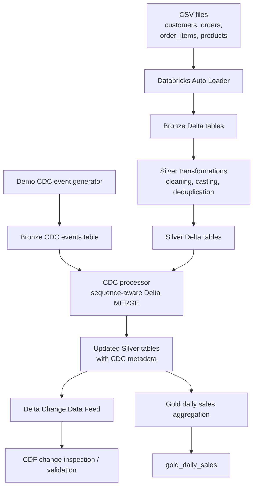
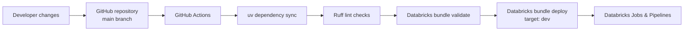
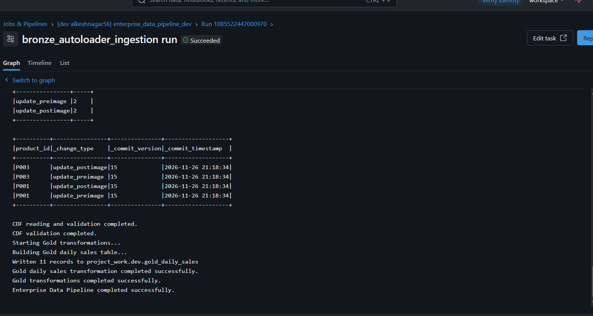
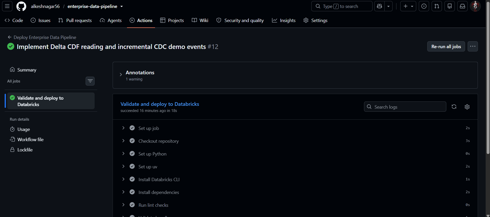

# Enterprise Data Pipeline

An end-to-end batch data engineering project built with **Databricks, PySpark, Delta Lake, Auto Loader, Delta Change Data Feed (CDF), Databricks Asset Bundles (DAB), and GitHub Actions**.

The project demonstrates a Medallion Architecture that ingests CSV data into Bronze, cleans and standardizes it in Silver, applies change events to Silver using Delta `MERGE`, reads the resulting Delta Change Data Feed, and produces a Gold daily-sales table.

> **Project status:** The Databricks job completed successfully in the latest documented run. GitHub Actions workflow run #12 also completed successfully, validating and deploying the bundle to the Databricks development target.

## Table of contents

- [What this project does](#what-this-project-does)
- [Architecture](#architecture)
- [Technology stack](#technology-stack)
- [Pipeline workflow](#pipeline-workflow)
- [Data layers and tables](#data-layers-and-tables)
- [CDC and Delta Change Data Feed](#cdc-and-delta-change-data-feed)
- [Repository structure](#repository-structure)
- [Configuration](#configuration)
- [Run and deploy](#run-and-deploy)
- [Validation evidence](#validation-evidence)
- [Important implementation notes and limitations](#important-implementation-notes-and-limitations)
- [Possible next steps](#possible-next-steps)

## What this project does

The pipeline processes four related retail/e-commerce entities:

- Customers
- Orders
- Order items
- Products

It uses Databricks Auto Loader to ingest CSV files incrementally into Delta Bronze tables. PySpark transformations create cleaned Silver tables. A demo CDC event source then generates insert/update/delete-style events, which are applied to Silver using Delta Lake `MERGE`. Delta CDF is read to inspect the table changes, and a Gold aggregation produces daily sales metrics.

The project is also packaged as a Databricks Asset Bundle and deployed to the development workspace through a GitHub Actions workflow.

## Architecture



### Deployment architecture



## Technology stack

| Technology | Purpose |
|---|---|
| Python 3.12 | Pipeline implementation |
| PySpark | Distributed data transformations |
| Databricks | Managed Spark execution and job orchestration |
| Databricks Auto Loader | Incremental file ingestion |
| Delta Lake | Storage, ACID transactions, and `MERGE` |
| Delta Change Data Feed | Reading row-level changes made to Delta tables |
| Databricks Asset Bundles | Declarative job/resource configuration and deployment |
| GitHub Actions | CI/CD automation |
| `uv` | Python dependency and environment management |
| Ruff | Python linting |

## Pipeline workflow

The main pipeline runs these stages in order:

1. **Bronze ingestion**
   - Reads CSV files for the four entities using Auto Loader.
   - Uses a separate source, schema, and checkpoint location for each entity.
   - Adds ingestion metadata such as `_ingestion_timestamp` and `_source_file`.
   - Writes the ingested data to Delta Bronze tables.

2. **Silver bootstrap and preparation**
   - Creates Silver tables from Bronze data when the Silver tables do not already exist.
   - Cleans string values, casts data types, parses dates, removes invalid primary keys, and deduplicates records.
   - Adds CDC tracking columns where required and enables Delta Change Data Feed.

3. **Demo CDC event generation**
   - Creates a batch of sample change events for the four entities.
   - Stores those events in the `bronze_cdc_events` Delta table.
   - Uses an event sequence to order changes.

4. **CDC processing**
   - Selects the latest event per key using its event sequence.
   - Applies changes to the corresponding Silver table with Delta `MERGE`.
   - Marks delete events as soft deletes by setting `_is_deleted = true`.
   - Stores the processed event sequence in `_cdc_sequence`.

5. **Delta CDF reading**
   - Captures table versions before CDC processing.
   - Reads the change feed for the versions created by the CDC operation.
   - Inspects `_change_type`, `_commit_version`, and `_commit_timestamp`.

6. **Gold transformation**
   - Reads active Silver orders and order items.
   - Aggregates daily sales metrics.
   - Writes the result to `gold_daily_sales`.

## Data layers and tables

The current development catalog and schema are `project_work.dev`.

| Layer | Table | Description |
|---|---|---|
| Bronze | `bronze_customers` | Raw customer CSV data with ingestion metadata |
| Bronze | `bronze_orders` | Raw order CSV data with ingestion metadata |
| Bronze | `bronze_order_items` | Raw order-item CSV data with ingestion metadata |
| Bronze | `bronze_products` | Raw product CSV data with ingestion metadata |
| Bronze | `bronze_cdc_events` | Generated demonstration CDC events |
| Silver | `silver_customers` | Cleaned customer data with CDC metadata |
| Silver | `silver_orders` | Cleaned order data with CDC metadata |
| Silver | `silver_order_items` | Cleaned order-item data with CDC metadata |
| Silver | `silver_products` | Cleaned product data with CDC metadata |
| Gold | `gold_daily_sales` | Daily sales aggregates |

### Storage locations

The CSV landing, schema, and checkpoint paths follow this pattern:

```text
/Volumes/{catalog}/{schema}/edp_storage/landing/csv/{entity}/
/Volumes/{catalog}/{schema}/edp_storage/schema/csv/{entity}/
/Volumes/{catalog}/{schema}/edp_storage/checkpoints/csv/{entity}/
```

For the current development configuration, `{catalog}` is `project_work` and `{schema}` is `dev`.

### Gold metrics

`gold_daily_sales` aggregates data by order date and includes:

- `total_orders`
- `delivered_orders`
- `total_revenue`
- `average_order_value`

The Gold transformation currently overwrites the aggregate table on each pipeline run.

## CDC and Delta Change Data Feed

This project demonstrates two related but different concepts:

- **CDC event processing:** The pipeline consumes records from the demo `bronze_cdc_events` table and applies the latest event per key to Silver using Delta `MERGE`.
- **Delta Change Data Feed:** After the Silver tables change, the pipeline reads Delta CDF to inspect the row-level changes committed to those Delta tables.

Silver tables use the following tracking columns:

| Column | Meaning |
|---|---|
| `_cdc_sequence` | Latest applied event sequence for the row |
| `_is_deleted` | Soft-delete flag; `true` means the row is logically deleted |

The CDC processor handles delete events as soft deletes. Therefore, Delta CDF reports the corresponding table operation as an `UPDATE` (with `update_preimage` and `update_postimage`) rather than a physical `delete`. This is expected for the current implementation.

### Latest observed CDF validation

In the documented successful run, each of the four Silver tables showed:

- 2 `update_preimage` records
- 2 `update_postimage` records

That represents two changed rows per table, each represented by its before and after images. The CDF output included the primary key, `_change_type`, `_commit_version`, and `_commit_timestamp`.

## Repository structure

The repository follows the Databricks Asset Bundle Python project layout:

```text
enterprise-data-pipeline/
├── .github/
│   └── workflows/
│       └── deploy.yml
├── resources/
│   └──                 # Databricks job/resource YAML definitions
├── src/
│   └── enterprise_data_pipeline/
│       ├── main.py
│       └── cdc/
│           ├── __init__.py
│           ├── event_source.py
│           └── processor.py
├── tests/
├── databricks.yml
├── pyproject.toml
├── uv.lock
└── README.md
```

The project also contains the Bronze, Silver, and Gold implementation modules under `src/enterprise_data_pipeline/`. The exact module filenames may evolve as the project is extended.

## Configuration

The bundle is named `enterprise_data_pipeline` and defines two targets:

| Target | Mode | Catalog | Schema |
|---|---|---|---|
| `dev` | Development | `project_work` | `dev` |
| `prod` | Production | `project_work` | `prod` |

The development target is the default target. The bundle builds a Python wheel using:

```bash
uv build --wheel
```

The project requires Python `>=3.12,<3.13`. The development dependency group includes Ruff, pytest, Databricks Connect `>=16.4,<16.5`, and related development tooling.

**Do not commit access tokens or credentials.** The GitHub Actions workflow expects these repository secrets:

- `DATABRICKS_HOST`
- `DATABRICKS_TOKEN`

Set them under the repository's **Settings → Secrets and variables → Actions**.

## Run and deploy

### 1. Clone the repository

```bash
git clone https://github.com/alkeshnagar56/enterprise-data-pipeline.git
cd enterprise-data-pipeline
```

### 2. Set up the Python environment

Install Python 3.12 and `uv`, then run:

```bash
uv sync --dev
```

### 3. Run local quality checks

```bash
uv run ruff check .
```

If tests are present and configured:

```bash
uv run pytest
```

### 4. Deploy through GitHub Actions

The workflow at `.github/workflows/deploy.yml` runs when code is pushed to `main`, or when manually triggered using `workflow_dispatch`.

It performs these steps:

1. Checks out the repository.
2. Sets up Python 3.12 and `uv`.
3. Installs the Databricks CLI.
4. Installs locked dependencies with `uv sync --frozen`.
5. Runs `uv run ruff check .`.
6. Validates the bundle using `databricks bundle validate --target dev`.
7. Deploys using `databricks bundle deploy --target dev`.

After a successful workflow, open the Databricks workspace and run the deployed development job from **Jobs & Pipelines**.

> The current CI/CD workflow deploys the `dev` target. Although a `prod` target is declared in `databricks.yml`, a production deployment workflow and production credentials/permissions are not documented as configured.

## Validation evidence

The screenshots below are from the project's successful validation run and deployment.

### Databricks job: CDF validation and Gold completion

The run output shows the CDF change records, successful CDF validation, 11 records written to `project_work.dev.gold_daily_sales`, and the final pipeline success message.



### GitHub Actions: CI/CD deployment success

The workflow completed successfully for commit `836551f` (`Implement Delta CDF reading and incremental CDC demo events`). The workflow validates and deploys the bundle to the Databricks development target.



## Important implementation notes and limitations

These details are important when evaluating or extending the project:

1. **The CDC source is simulated.** The demo event generator creates sample update and delete events. It does not capture changes from a live database transaction log or external CDC platform.
2. **Auto Loader is file-ingestion, not database CDC.** It detects new files and processes them incrementally. Editing an already-ingested CSV file in place does not, by itself, create source-level update/delete events for this pipeline.
3. **The demo event generator appends a new batch of events on each execution.** The current demo generates eight events per run (two per entity). Re-running the job changes the demo data again; it should not be treated as a passive read-only validation run.
4. **Deletes are logical, not physical.** A delete event sets `_is_deleted = true`. Downstream Gold logic filters out soft-deleted rows.
5. **Gold is rebuilt on each run.** The current daily-sales aggregate uses overwrite rather than an incremental Gold merge.
6. **The documented CI/CD path deploys to `dev`.** A production target exists in the bundle configuration, but production deployment should be configured and tested separately before use.

For real source-system CDC, connect an appropriate source-specific capture mechanism (for example, database log-based CDC tooling or a supported ingestion service) and map its events into the event contract consumed by the processor.

## Possible next steps

The core pipeline and deployment path are working. Useful next steps are:

- Integrate cloud object storage such as Azure Data Lake Storage Gen2.
- Add a real source ingestion/CDC connector appropriate to the chosen source system.
- Add data-quality checks and automated tests for transformations and CDC edge cases.
- Introduce orchestration and environment-specific configuration for a production deployment.
- Consider incremental Gold processing if the data volume and latency requirements justify it.

These are extension ideas, not claims about features already implemented.
